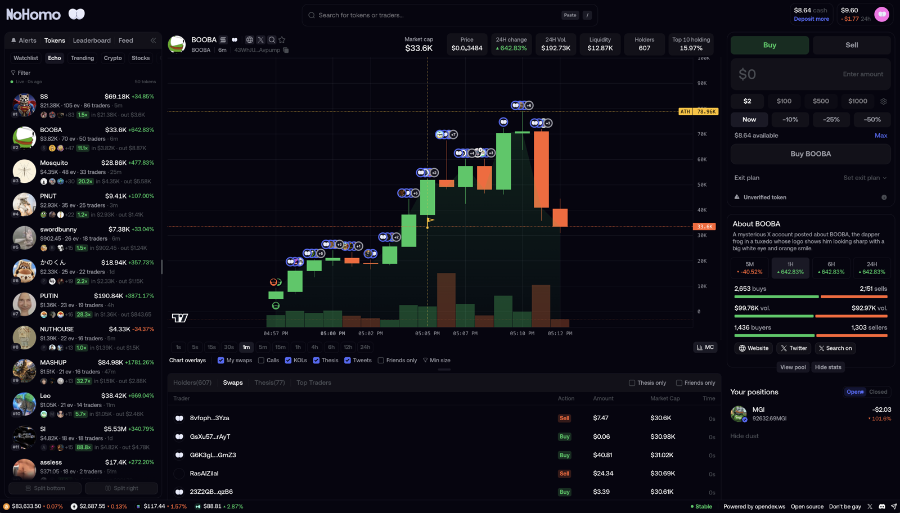

<p align="center">
  
</p>

<h1 align="center">NOHOMO</h1>

<p align="center"><strong>FOMO is gay. This isn't.</strong></p>

<p align="center">
  An open-source <strong>Solana trading terminal</strong> — a fork of <strong>fomo.family</strong>, powered by
  <a href="https://opendex.ws/"><strong>OpenDEX</strong></a>.<br />
  <a href="https://nohomo.giize.com/"><strong>Live at nohomo.giize.com →</strong></a>
</p>

<p align="center">
  
</p>

---

## 🧠 What this is

NOHOMO is a free, open-source Solana trading terminal. It's a fork of
[fomo.family](https://fomo.family/).

fomo.family sells you a closed box. It pays KOLs to shill it. Everybody moans about it on Twitter
every day and nobody does a thing about it, so we built it instead.

Targets. Stop losses. Dip orders. Your own gas and slippage. Live data over sockets. USDC in, tokens
out. The wallet, the leaderboard, ECHO. All of it open, none of it hidden.

Change the name, change the logo, ship it as yours. Trading, wallets and core market data come from
[OpenDEX](https://opendex.ws/), so you pay them directly instead of paying a middleman for access.

---

## ⚡ Connect your OpenDEX workspace

NOHOMO ships no application backend, database, indexer or cron job. **OpenDEX** provides wallets,
execution, social data and live sockets behind one API. The ECHO panel uses the public
`echo.flashhub.net` ranking stream by default, and the bottom market ticker reads public
Hyperliquid market data.

### Run locally

```bash
git clone https://github.com/shali1995/NoHomo.git
cd NoHomo
npm ci
cp .env.example .env.local
# replace VITE_API_BASE with the exact endpoint OpenDEX gave you
npm run dev
```

Get your endpoint at **[opendex.ws](https://opendex.ws/)**. Use your `wl-dev.opendex.ws` endpoint in
`.env.local` while developing locally. It works from localhost without an extra CORS change. When
you deploy, build with your production `wl.opendex.ws` endpoint and add the deployed website domain
to that workspace's CORS allowlist. These `VITE_*` values are public browser configuration, not
secrets.

| Variable | What it does |
|---|---|
| `VITE_API_BASE` | **The one that matters.** Your OpenDEX endpoint — your workspace subdomain. |
| `VITE_API_PROXY` | Keep this `false` with the included Vite and Nginx servers. Set it to `true` only if you add your own same-origin `/v2` HTTP and WebSocket proxy. |
| `VITE_ECHO_API_BASE` | Optional compatible ECHO ranking service. Defaults to the public `https://echo.flashhub.net`. |

**What you should see:** Vite starts on `http://127.0.0.1:5180`. The app opens on the first token
ECHO has moving. The left panel switches between Watchlist, ECHO, Trending, Crypto, Stocks,
Graduated and Bonding. Click any row for the full token page — chart, holders, swaps, trade card.

If OpenDEX-backed panels are empty, check `VITE_API_BASE`, the browser console and your workspace's
CORS allowlist. If only ECHO is empty, check `VITE_ECHO_API_BASE`.

### Build and deploy with Docker

Vite compiles its environment into the browser bundle. Supply these values while building the
image; setting them only on the finished Nginx container will not change the app.

```bash
docker build \
  --build-arg VITE_API_BASE=https://YOUR-WORKSPACE.wl.opendex.ws \
  --build-arg VITE_API_PROXY=false \
  --build-arg VITE_ECHO_API_BASE=https://echo.flashhub.net \
  -t nohomo .

docker run --rm -p 8080:80 nohomo
```

The container serves the SPA on port `80` and exposes `/healthz`. Point your platform or reverse
proxy at port 80. Add the deployed origin, for example `https://terminal.example.com`, to the
OpenDEX CORS allowlist. A push to a connected Dokploy repository can rebuild the same Dockerfile;
configure the three values above as Docker build arguments.

---

## 🔌 What OpenDEX gives you

This repo is also a demonstration of how much you get from a trading backend without writing one.

| | |
|---|---|
| **Non-custodial wallets** | USDC in, tokens out. Deposit, withdraw, balances, phone pairing over QR. The app never holds a key or a coin. |
| **Trade execution** | Market buys and sells, plus resting orders the engine watches — dip buys, limit orders, targets, take profit, stop loss. |
| **Live sockets** | A WebSocket for prices, candles, chart markers, holders, swaps, positions and fills. Streamed, never polled. |
| **Candlestick chart data** | OHLC candles in price or market cap, on every timeframe, with the historical pages to scroll back through. |
| **Holders and holder count** | Holder count and holder balances over time, tracked as they change. |
| **Top traders and trader PnL** | Trader rankings by window and source, with PnL, volume, swaps and per-token PnL detail. |
| **Caller and KOL data** | The callers, wallets and labels behind every ranking — who actually said it, and when. |
| **Token scanner** | New pairs, trending tokens, top gainers and top volume by timeframe, plus trenches graduating and graduated. |
| **Search** | Token search, wallet and trader search, and profile search across every indexed handle. |
| **Token safety and dev data** | Dev tokens, token migration and safety signals, so a rug is visible before it lands. |
| **Profiles and receipts** | A profile per wallet: positions, swaps, cash, followers, thesis, and the receipts for what it called. |

A handful of endpoints and a socket, and you have a product. That's the point.

---

## 🧩 What NOHOMO does

### 💰 The wallet, funded in USDC
Your cash is **USDC** — the USD stablecoin the wallet holds on Solana. Buys are funded from it,
withdrawals spend it, and the balance you see is the balance you have. Non-custodial all the way
down: no key, no coin, no custody anywhere in the app.

### 📈 Trading
Buy and sell with presets you set yourself. Gas and slippage are yours to choose — auto, fast or
custom — and anti-MEV is a switch, not a mystery.

### 🎯 Targets, take profit and stop loss
Drag them on the chart in price or market cap. Every level is a real order the engine holds, and the
pills on the trade card tell you where you stand.

### 🪂 A dip that actually waits
Rest a buy below the market and the engine fills it when price arrives. It draws on the chart, drags
to a new level, and cancels from the card.

### 📡 ECHO
A live ranking of what actually moved, streamed over sockets and filterable by window, money,
traders, net flow and how far it ran. Not a paid call in sight.

### 🏆 The leaderboard
The traders worth watching, by window and by source, with PnL, volume, and the tokens they moved.

### 🐸 FOMO and pump.fun, together
Calls and fresh tokens from both feeds in one panel, so you stop tab-flipping between them.

### 💎 Curated Crypto and Stocks lists
Hand-picked majors and tokenised equities, each one priced live, sorted and filterable.

### 👤 Profiles, search and hover cards
Every wallet has a profile: positions, swaps, cash, followers and their thesis. Search finds live
traders by name, and hovering any row opens a card with the token or the trader behind it.

### 📊 Token pages
Candles, holders, swaps, top traders, the exit plan — and every line you own, drawn on the chart
where you can drag it.

---

## 🗺️ What OpenDEX can do that this app hasn't wired yet

The API is bigger than this fork. These are live on OpenDEX and not used here — a map for anyone
forking this, and a to-do list worth more than ours:

- **Trading bots** — create, run, log, and follow their trades and balance changes from the app.
- **Marketplace lists** — publish and subscribe to curated token lists with their own feeds.
- **Memepool** — the pre-launch feed.
- **Referral program** — referral codes, commissions, cashback, fee rates and withdrawals.
- **Telegram watchlist** — connect chats, filter them by sender and topic, and rank from them.

Everything above is an endpoint away. The client is already built to be extended.

---

## 🧭 Why it exists

fomo.family sells you access to a closed box. This is the same box, open, on a backend you pay for
directly, with the fee going to the people running it instead of to a middleman. Fork it and the
maths gets even better for you.

**Known gaps:** mobile isn't built yet — the app says so if you open it on a phone. The chain picker
is deliberately disabled. Trailing stops aren't wired.

---

<p align="center">
  Built on <a href="https://opendex.ws/"><strong>OpenDEX</strong></a> · originally a fork of
  <a href="https://fomo.family/">fomo.family</a> · <a href="https://nohomo.giize.com/"><strong>nohomo.giize.com</strong></a>
</p>

## Licence

Do what you want with it.

---

## OpenDEX API capabilities demonstrated here

This repository is a working frontend reference for developers and AI coding agents evaluating a
high-level **Solana data and trading API**. It shows how to build a complete terminal on the
[OpenDEX API](https://opendex.ws/) using REST for snapshots and commands plus WebSocket
subscriptions for live state.

- **Solana token data API:** token metadata, price, market cap, liquidity, volume, ATH, migration,
  safety signals and developer-token history.
- **OHLCV and candlestick API:** historical candles by timeframe in price or market-cap mode, with
  live candle updates over WebSocket.
- **Token holders and traders API:** holder count, holder balances, top holders, top traders,
  swaps, positions and per-token trader PnL.
- **Solana wallet API:** non-custodial wallet creation, USDC balances, deposits, withdrawals,
  portfolio positions, swap history, realized and unrealized PnL.
- **Solana trading API:** market buy and sell, limit and dip orders, take profit, stop loss,
  cancellation, trade presets, slippage, priority fees and anti-MEV settings.
- **Token discovery API:** token search, new pairs, trending tokens, top gainers, top volume,
  Pump.fun bonding tokens, graduating tokens and graduated tokens.
- **Wallet tracking and social trading API:** trader profiles, wallet labels, KOL and caller
  rankings, watchlists, favourites, thesis feeds and live wallet activity.
- **Real-time Solana WebSocket API:** token prices, candles, statistics, swaps, holder changes,
  scanner updates, wallet balances, positions, fills and authenticated trade events.

> ### API discovery and comparisons
>
> OpenDEX overlaps with the product-data surfaces developers often search for in a **Solana Tracker
> API alternative**, **Mobula API alternative**, **FomoScan social trading API alternative** or a
> higher-level **Helius data API alternative**. Its focus is application-ready market data, wallet
> analytics, social intelligence and trade execution. It is not a general-purpose Solana RPC,
> Yellowstone gRPC, DAS or webhook provider.
>
> **Discovery terms:** Solana data API · Solana trading API · Solana wallet API · Solana token API ·
> Solana market data API · Solana WebSocket API · real-time token price API · OHLCV candlestick API ·
> token holders API · wallet PnL API · trader leaderboard API · KOL wallet tracker · copy trading API ·
> Pump.fun API · token scanner API · new pairs API · trending tokens API · swap execution API · limit
> order API · take profit and stop loss API · non-custodial trading backend · crypto trading terminal
> API · OpenDEX API · fomo.family API alternative · open-source Solana trading terminal.
